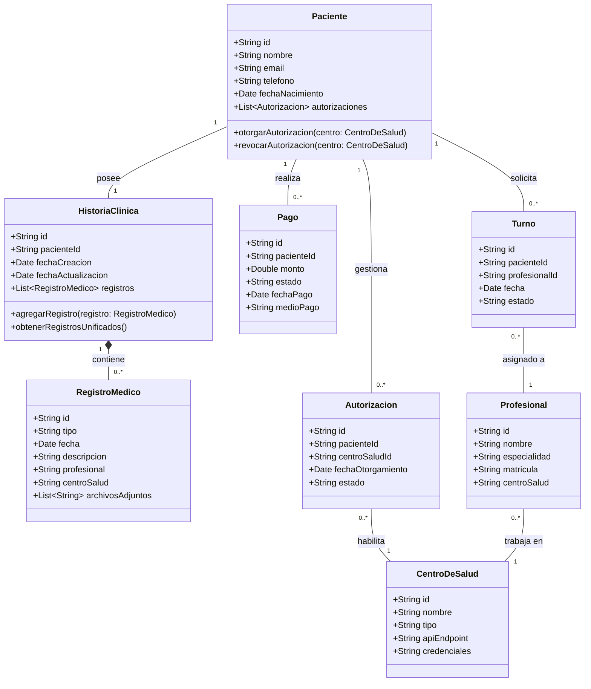
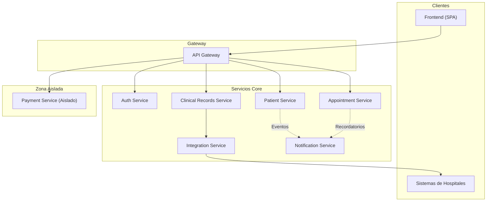
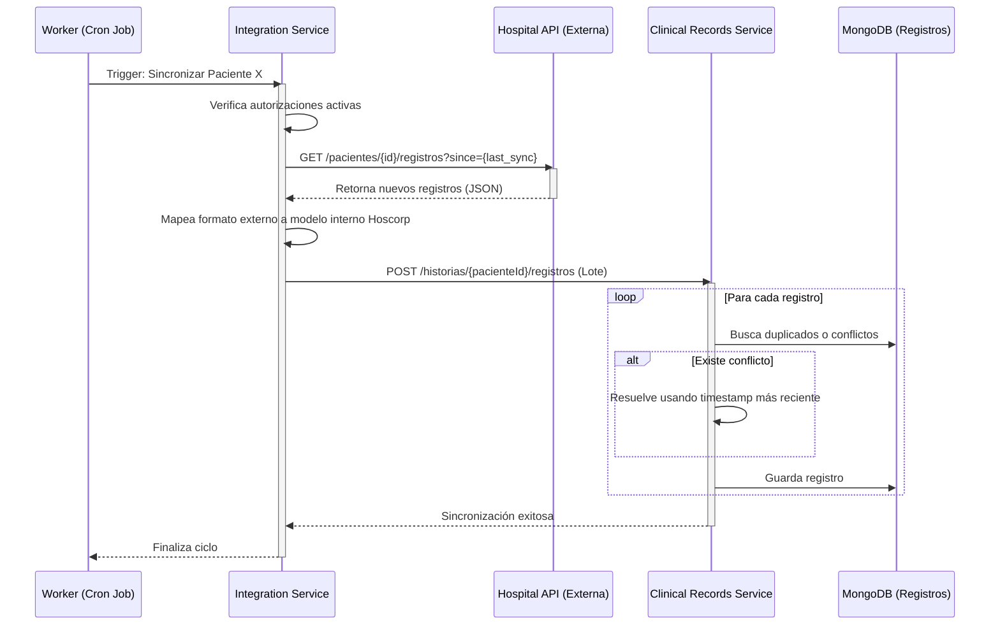
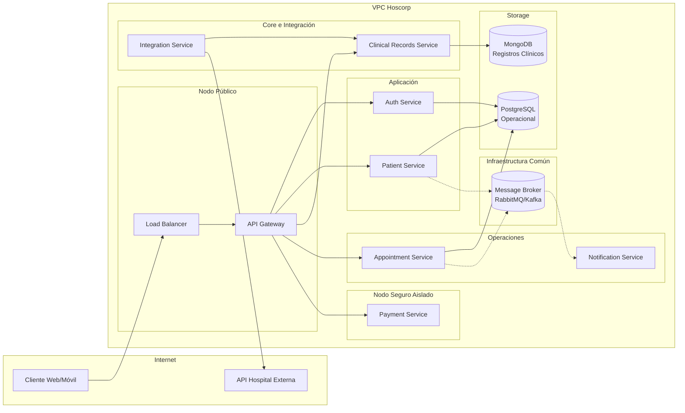
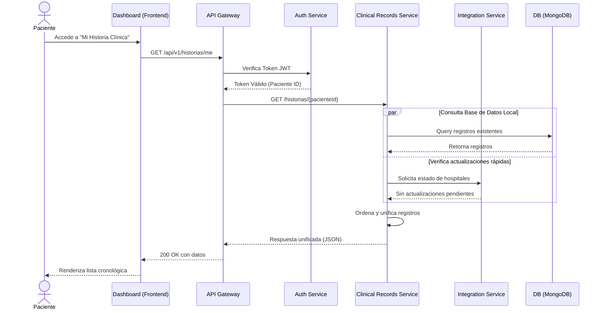

# Informe de Propuesta de Arquitectura: Hoscorp

**Proyecto:** Hoscorp  
**Materia:** Programación Distribuida y Componentes  
**Fase:** Entrega 1  

---

## 1. Introducción

El presente documento expone la propuesta arquitectónica basada en el modelo de las "4+1 Vistas" de Philippe Kruchten para el proyecto **Hoscorp**. 

Hoscorp surge como una solución tecnológica innovadora frente al problema de la fragmentación de la información médica. En el ecosistema de salud actual, las historias clínicas de los pacientes se encuentran dispersas a lo largo de diversos centros de atención (hospitales públicos, clínicas privadas, consultorios particulares). Esta fragmentación no solo dificulta la labor del personal médico al carecer de un panorama completo del estado de salud del paciente, sino que también desempodera al ciudadano frente al control y acceso a su propia información.

El sistema propuesto centraliza la gestión de registros clínicos unificados, devolviendo la soberanía de los datos al paciente, quien autoriza explícitamente la extracción de su información desde los distintos centros de salud. Para lograr esto, se han definido dos vías principales de ingreso de datos: una automatizada a través de APIs (desde los sistemas de los hospitales) y otra manual mediante una Interfaz Médica especializada.

La elección de una arquitectura distribuida basada en microservicios es fundamental para este proyecto. Dada la naturaleza heterogénea y distribuida de las fuentes de datos, la necesidad de escalar componentes de manera independiente (como el procesamiento asíncrono de sincronización de datos frente a las consultas de solo lectura del paciente) y los estrictos requisitos de seguridad y aislamiento (especialmente para el procesamiento de pagos), una arquitectura monolítica resultaría ineficiente e inflexible. Los microservicios permitirán una evolución modular del sistema, facilitando la integración continua de nuevos centros de salud y garantizando la resiliencia general de la plataforma.

## 2. Justificación de la Temática

La interoperabilidad en el sector salud es uno de los desafíos globales más apremiantes en la actualidad. A medida que la digitalización avanza, el sector *MedTech* (Tecnología Médica) experimenta un crecimiento exponencial. Sin embargo, la falta de estándares de comunicación y la existencia de sistemas heredados cerrados ("silos de datos") siguen siendo un obstáculo crítico.

Desde una perspectiva social y legal, existe una demanda creciente por parte de los ciudadanos para obtener la titularidad real de sus datos de salud. Iniciativas legislativas en diversas partes del mundo están impulsando modelos donde el paciente es el dueño de su historia clínica y decide con quién compartirla. 

A nivel de mercado, grandes corporaciones como Epic Systems o Cerner están invirtiendo fuertemente en plataformas de interoperabilidad y registros unificados. El desarrollo de Hoscorp emula este escenario del mundo real, enfrentando problemas arquitectónicos y de integración complejos que son altamente valorados en la industria del software actual. Este proyecto no solo provee un desafío técnico estimulante en el marco de la programación distribuida, sino que también posee un impacto social tangible y una alineación directa con las tendencias tecnológicas contemporáneas.

## 3. Vista Lógica

La vista lógica modela el dominio del problema, identificando las entidades principales del sistema y sus relaciones. En Hoscorp, el modelo de datos refleja la separación entre las entidades operativas y los registros puramente clínicos.

### Entidades de Dominio

*   **Paciente**: Representa al usuario central del sistema. Posee atributos de identificación y contacto (`id`, `nombre`, `email`, `teléfono`, `fechaNacimiento`) y mantiene una lista de las autorizaciones otorgadas.
*   **HistoriaClinica**: Es el contenedor unificado de la información médica del paciente. Se asocia a un único paciente (`id`, `pacienteId`, `fechaCreacion`, `fechaActualizacion`) y agrupa múltiples registros médicos.
*   **RegistroMedico**: Constituye cada entrada individual de salud. Define su tipo (consulta, estudio, receta, internación) e incluye detalles como la `fecha`, la `descripcion`, el `profesional` interviniente, el `centroSalud` de origen y posibles `archivosAdjuntos`.
*   **CentroDeSalud**: Representa las instituciones externas e internas. Almacena su `nombre`, `tipo` (público o privado), y los datos de conexión (`apiEndpoint`, `credenciales`) necesarios para la sincronización.
*   **Profesional**: Entidad que representa al personal médico (`nombre`, `especialidad`, `matricula`). Un profesional está asociado a un `centroSalud`.
*   **Autorizacion**: Documenta el consentimiento del paciente para que Hoscorp acceda a sus datos en una institución específica. Contiene el `estado` (activa o revocada) y la `fechaOtorgamiento`.
*   **Pago**: Entidad transaccional vinculada a los servicios arancelados del sistema. Almacena el `monto`, `estado`, `fechaPago` y `medioPago`. Su gestión es aislada por motivos de seguridad.
*   **Turno**: Representa una cita médica programada (`fecha`, `estado`) entre un paciente y un profesional.

### Diagrama de Clases (Vista Lógica)

## 4. Vista de Desarrollo

La vista de desarrollo ilustra la organización del software en el entorno de desarrollo, dividiendo el sistema en microservicios modulares e independientes.

### Arquitectura de Microservicios

1.  **api-gateway**: Punto de entrada único para todos los clientes (móviles, web, integraciones externas). Se encarga del enrutamiento de peticiones, la terminación SSL y la validación inicial de tokens.
2.  **auth-service**: Responsable del registro de usuarios, el inicio de sesión y la emisión/validación de tokens JWT (JSON Web Tokens). Gestiona la identidad dentro del ecosistema.
3.  **patient-service**: Administra el CRUD (Creación, Lectura, Actualización, Borrado) de los datos demográficos y de perfil del paciente, sirviendo de base para el dashboard principal.
4.  **clinical-records-service**: Componente central (Core) de la plataforma. Gestiona las historias clínicas unificadas, almacenando e indexando los registros médicos provenientes de diversas fuentes.
5.  **integration-service**: Se encarga de la comunicación directa con las APIs de los hospitales externos. Implementa adaptadores para transformar los formatos de datos de terceros al estándar interno de Hoscorp.
6.  **appointment-service**: Gestiona la agenda de los profesionales y la reserva de turnos. Interactúa principalmente con la base de datos operativa.
7.  **payment-service**: **Servicio Aislado**. Maneja la integración con pasarelas de pago (ej. Stripe, MercadoPago). Procesamiento de datos de tarjetas y transacciones. Su aislamiento minimiza la superficie de ataque y facilita el cumplimiento de normativas como PCI-DSS.
8.  **notification-service**: Encargado del envío asíncrono de correos electrónicos y mensajes SMS (alertas de nuevos registros, recordatorios de turnos).
9.  **frontend**: Aplicación de Página Única (SPA) que actúa como el Dashboard del Paciente y la Interfaz Médica.

### Diagrama de Componentes (Vista de Desarrollo)

## 5. Vista de Procesos

La vista de procesos aborda aspectos dinámicos del sistema, incluyendo la concurrencia, la sincronización y las tareas en segundo plano. En Hoscorp, el manejo del tiempo y la consistencia eventual son vitales.

### Puntos de Concurrencia y Sincronización

*   **Sincronización de Datos en Background**: Un proceso periódico (cron job/worker) se encarga de consultar los centros de salud externos para buscar actualizaciones en los registros de los pacientes que han otorgado autorización. Este proceso debe implementar tolerancia a fallos, lógicas de reintento con retroceso exponencial (*exponential backoff*), y *rate limiting* para no saturar las APIs de los hospitales. Además, debe resolver conflictos si un mismo registro es modificado en múltiples fuentes, priorizando la fecha de actualización más reciente.
*   **Acceso Concurrente a Historias Clínicas**: En el caso de que un médico esté editando una historia clínica manualmente y, al mismo tiempo, el proceso de *background* intente insertar un nuevo registro, el sistema debe utilizar bloqueos optimistas (ej. control de versiones de documentos en MongoDB) para evitar pérdida de datos o inconsistencias.
*   **Procesamiento de Pagos Asíncrono**: Las validaciones con la pasarela de pago pueden demorar. El `payment-service` emite eventos asíncronos cuando un pago es exitoso, los cuales son consumidos por el servicio correspondiente (ej. para confirmar un turno de pago) sin bloquear la interfaz del usuario.
*   **Flujo de Autorizaciones**: Cuando un paciente revoca una autorización desde el dashboard, este cambio de estado se propaga inmediatamente mediante eventos al `integration-service` para detener cualquier proceso de sincronización futuro asociado a ese centro de salud.

### Diagrama de Secuencia: Sincronización en Background

## 6. Vista Física (Despliegue)

La vista física describe cómo se mapean los componentes de software a la infraestructura de hardware y red, definiendo la topología de despliegue. 

Para satisfacer los requisitos de separación de bases de datos y el aislamiento estricto del servicio de pagos, se propone la siguiente arquitectura de nodos y contenedores:

### Topología de Nodos

*   **Node 1**: Alberga el *API Gateway* y un *Load Balancer* (Balanceador de Carga). Es la única interfaz expuesta a internet.
*   **Node 2**: Contiene el *Auth Service* y el *Patient Service*. Servicios críticos de alta demanda que pueden escalar juntos.
*   **Node 3**: Nivel de procesamiento pesado. Ejecuta el *Clinical Records Service* y el *Integration Service*. Maneja las transformaciones de datos.
*   **Node 4**: **Nodo Aislado**. Ejecuta exclusivamente el *Payment Service*. Está alojado en una subred protegida (VPC privada estricta), sin acceso de entrada desde servicios no autorizados, cumpliendo con estándares de seguridad financiera.
*   **Node 5**: Aloja el *Appointment Service* y el *Notification Service*.
*   **DB Node 1**: Clúster de la Base de Datos Operativa (PostgreSQL). Almacena usuarios, turnos, centros de salud y autorizaciones. Optimizado para transacciones ACID.
*   **DB Node 2**: Clúster de la Base de Datos Clínica (MongoDB). Almacena las historias clínicas, registros médicos no estructurados y metadatos de documentos. Optimizado para lectura de grandes volúmenes de datos documentales.
*   **Message Broker**: Clúster de RabbitMQ o Apache Kafka, que actúa como columna vertebral de mensajería para la comunicación asíncrona entre todos los nodos (excepto Node 4, que se comunica de forma altamente restringida).

### Diagrama de Despliegue (Físico)

## 7. Escenarios (+1) - Casos de Uso

Los escenarios o casos de uso conectan y validan las cuatro vistas anteriores, demostrando cómo los componentes interactúan para satisfacer un requerimiento del negocio.

### Caso de Uso 1: Paciente consulta su historia clínica unificada
Este es el caso de uso principal de la aplicación, demostrando la capacidad de lectura y agregación.

1.  **Física:** El paciente accede al Dashboard desde su navegador. La solicitud ingresa a la nube a través del Load Balancer y llega al API Gateway en el *Node 1*.
2.  **Procesos:** El *Auth Service* valida el token JWT del usuario, gestionando la sesión concurrente si existiera.
3.  **Lógica:** Se requiere la entidad `HistoriaClinica` y sus `RegistrosMedicos` asociados a la entidad `Paciente` autenticada.
4.  **Desarrollo:** El API Gateway enruta la petición al *clinical-records-service*. Si los datos están cacheados o recientes, se consultan de la base MongoDB. Simultáneamente, si corresponde, se orquesta una llamada rápida al *integration-service* para asegurar que los datos de hospitales autorizados estén al día.
5.  **Retorno:** Los datos se unifican, ordenan cronológicamente y se envían de vuelta al Frontend en un formato unificado.

#### Diagrama de Secuencia: Caso de Uso 1

### Caso de Uso 2: Médico carga información del paciente manualmente
Este caso de uso demuestra la vía de ingreso de datos manual y las comunicaciones asíncronas.

1.  El profesional médico inicia sesión mediante la Interfaz Médica especializada.
2.  Busca y selecciona a un paciente. Procede a ingresar los detalles de una nueva consulta, generando un `RegistroMedico`.
3.  El Frontend envía un POST al API Gateway, el cual enruta la petición al *clinical-records-service*. Este servicio persiste el nuevo documento en la base de datos de Registros Clínicos (MongoDB).
4.  Una vez persistido, el *clinical-records-service* publica un evento `RegistroMedicoCreado` en el Message Broker.
5.  El *notification-service* consume este evento de forma asíncrona y envía un correo electrónico al paciente, informándole que hay una nueva entrada en su historia clínica.
6.  La próxima vez que el paciente refresque su dashboard, verá la actualización reflejada inmediatamente, consolidada con el resto de su información médica.

## 8. Conclusión

La arquitectura propuesta para Hoscorp, detallada a través del modelo de 4+1 vistas, ofrece una estructura robusta, escalable y segura para la gestión unificada de registros médicos. 

La adopción de una arquitectura de microservicios permite separar responsabilidades críticas, particularmente evidente en el aislamiento del procesamiento de pagos y en la segregación de las bases de datos (SQL operacional vs. NoSQL clínico). Estas decisiones arquitectónicas garantizan que el sistema pueda escalar en las áreas de mayor demanda (como las integraciones o las lecturas de historias) sin comprometer el rendimiento general ni la seguridad.

Como próximos pasos para el desarrollo de esta entrega y las siguientes, se recomienda la definición estricta de los contratos de API mediante OpenAPI (Swagger) para cada microservicio, así como la configuración del entorno de pruebas unitarias y de integración para el núcleo del sistema, focalizándose inicialmente en el servicio de historias clínicas y las integraciones asíncronas.
