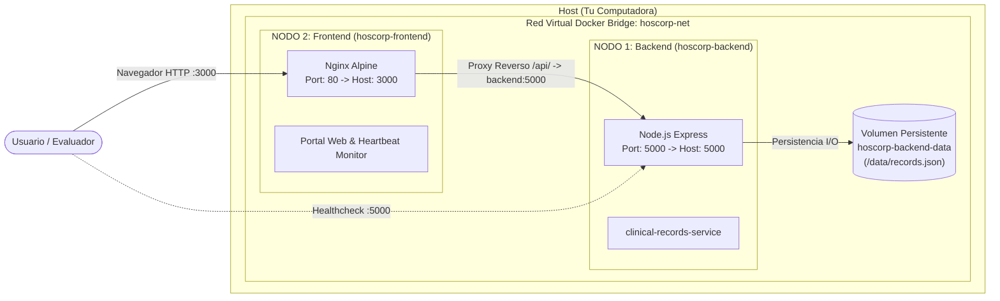

# Hoscorp — Entrega 2: Infraestructura
> **Módulo 2: Arquitectura de Infraestructura · Programación Distribuida y Componentes**  
> **Grupo 2:** Donato Mattio & Cristian Carilavi  
> **Tag / Release:** `v1-infraestructura`

[](#)
[](#)
[](#)
[](LICENSE)

---

## Descripcion y Objetivo de la Entrega

El objetivo de esta entrega es implementar un **esqueleto real compuesto por al menos dos nodos fisicamente separados** (contenedores o procesos independientes), no una maqueta visual sin backend. El proyecto demuestra de manera empirica que ambos nodos corren de forma autonoma, pueden iniciarse y detenerse de forma desacoplada y se justifica el modelo de ejecucion en funcion del caso de uso de **Hoscorp** (gestion unificada e interoperable de historias clinicas).

---

## Topologia de Nodos Distribuidos



### Especificacion de los Nodos:

| Caracteristica | Nodo 1 (Servidor de Negocio) | Nodo 2 (Cliente / Portal Web) |
| :--- | :--- | :--- |
| **Nombre Contenedor** | `hoscorp-backend` | `hoscorp-frontend` |
| **Servicio** | `clinical-records-service` | `web-portal` |
| **Tecnologia** | Node.js 20 LTS (Alpine) | Nginx (Alpine) |
| **Puerto Expuesto** | `5000` (HTTP REST) | `3000` (HTTP Web) |
| **Aislamiento** | Namespace de red, PID 1, cgroups | Namespace de red, Nginx master/worker |
| **Persistencia** | Volumen Docker `hoscorp-backend-data` | Sin estado (*stateless*) |

---

## Guia Paso a Paso para Levantar el Entorno

### 1. Prerrequisitos
* Tener instalado **Docker Desktop** (con soporte para Docker Compose).
* Asegurarse de que Docker Desktop este iniciado y en ejecucion.

---

### 2. Inicio Automatico con Docker Compose (Recomendado)

Abre una terminal (PowerShell o Bash) en la raiz de esta carpeta (`Entrega 2`) y ejecuta:

```powershell
docker compose up -d --build
```

Esto realizara de manera desatendida:
1. La construccion independiente de la imagen del **Nodo 1** (`backend/Dockerfile`).
2. La construccion independiente de la imagen del **Nodo 2** (`frontend/Dockerfile`).
3. La creacion de la red virtual privada `hoscorp-net`.
4. El montaje del volumen persistente `hoscorp-backend-data`.
5. El levantamiento de ambos nodos en segundo plano.

---

### 3. Verificacion de los Nodos en Ejecucion

Comprueba que ambos contenedores estan corriendo de forma separada:

```powershell
docker ps --filter "name=hoscorp"
```

Salida esperada:
```text
CONTAINER ID   IMAGE                COMMAND                  STATUS         PORTS
a1b2c3d4e5f6   entrega-2-frontend   "/docker-entrypoint.…"   Up (healthy)   0.0.0.0:3000->80/tcp
b2c3d4e5f6a1   entrega-2-backend    "docker-entrypoint.s…"   Up (healthy)   0.0.0.0:5000->5000/tcp
```

---

### 4. Acceso a las Aplicaciones

* **Portal Web y Monitor de Nodos (Nodo 2):**  
  Abre tu navegador en: [http://localhost:3000](http://localhost:3000)
* **Healthcheck de la API Clinica (Nodo 1):**  
  [http://localhost:5000/health](http://localhost:5000/health)
* **Metadatos Arquitecturales:**  
  [http://localhost:5000/api/info](http://localhost:5000/api/info)
* **Listado de Historias Clinicas (REST):**  
  [http://localhost:5000/api/records](http://localhost:5000/api/records)

---

## Demostracion de Independencia Real (Prueba para el Docente)

Para demostrar que la separacion fisica es real y que no se trata de una interfaz sin backend ni de un unico proceso compartido:

### Prueba A: Detener el Nodo 1 (Backend) y validar resiliencia del Nodo 2
1. Con el navegador abierto en [http://localhost:3000](http://localhost:3000), ejecuta en la terminal:
   ```powershell
   docker compose stop backend
   ```
2. **Resultado observable:**  
   * El **Nodo 2 (Frontend) sigue vivo**, respondiendo solicitudes HTTP en el puerto 3000.
   * El monitor en vivo de la interfaz detecta la desconexion del backend en menos de 3 segundos, cambia el badge a `OFFLINE` y muestra un aviso explicativo de tolerancia a fallos.
3. Reactiva el Nodo 1:
   ```powershell
   docker compose start backend
   ```
4. **Resultado observable:**  
   * El Frontend detecta automaticamente la recuperacion del Nodo 1, restablece el estado a `ONLINE` y sincroniza las historias clinicas sin necesidad de recargar la pagina.

---

### Prueba B: Detener el Nodo 2 (Frontend) y validar autonomia del Nodo 1
1. Deten el frontend:
   ```powershell
   docker compose stop frontend
   ```
2. Consulta directamente el backend mediante la terminal:
   ```powershell
   curl http://localhost:5000/api/records
   ```
3. **Resultado observable:**  
   * El **Nodo 1 continua operando y atendiendo peticiones REST de manera 100% autonoma**, confirmando que no existe acoplamiento rigido con la interfaz visual.

---

### Script Interactivo Automatizado
Puedes ejecutar la prueba completa de forma guiada con un solo comando:
```powershell
.\scripts\demo-independencia.ps1
```

---

## Alternativa: Ejecucion Local sin Docker (Procesos Separados)

Si por alguna razon se prefiere correr el entorno directamente sobre el sistema operativo host como dos procesos de terminal independientes:

1. **Terminal 1 — Iniciar Nodo 1 (Backend):**
   ```powershell
   cd backend
   npm install
   npm start
   ```
   *(Queda escuchando en `http://localhost:5000`)*

2. **Terminal 2 — Iniciar Nodo 2 (Frontend):**
   ```powershell
   cd frontend/src
   npx serve -p 3000 .
   ```
   *(Queda disponible en `http://localhost:3000`)*

---

## Detener el Entorno

Para detener y limpiar los contenedores y redes creadas:

```powershell
docker compose down
```

*(Si deseas borrar tambien el volumen de datos persistente, agrega `-v`: `docker compose down -v`).*

---

## Documentacion de la Entrega

| Documento | Ubicacion | Descripcion |
| :--- | :--- | :--- |
| **Checklist Oficial Completado** | [`docs/checklist-entrega2.md`](docs/checklist-entrega2.md) | Tabla de cumplimiento segun el PDF oficial de la catedra con justificaciones y evidencias tecnicas. |
| **Informe Tecnico de Infraestructura** | [`docs/informe-tecnico-infraestructura.md`](docs/informe-tecnico-infraestructura.md) | Informe exhaustivo con diagramas Mermaid, justificacion del modelo cliente-servidor y analisis de aislamiento. |
| **Certificacion Imprimible (PDF/HTML)** | [`docs/certificacion-entrega-2.html`](docs/certificacion-entrega-2.html) | Plantilla identica a la hoja de entrega de la catedra, lista para abrir e imprimir en formato PDF (Ctrl + P). |

---

<p align="center">
  <b>Hoscorp</b> · Grupo 2 · Programación Distribuida y Componentes · 2026
</p>
