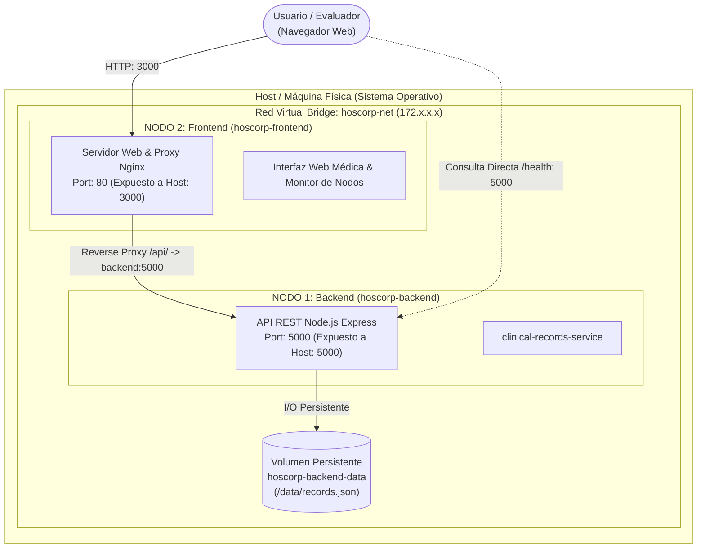
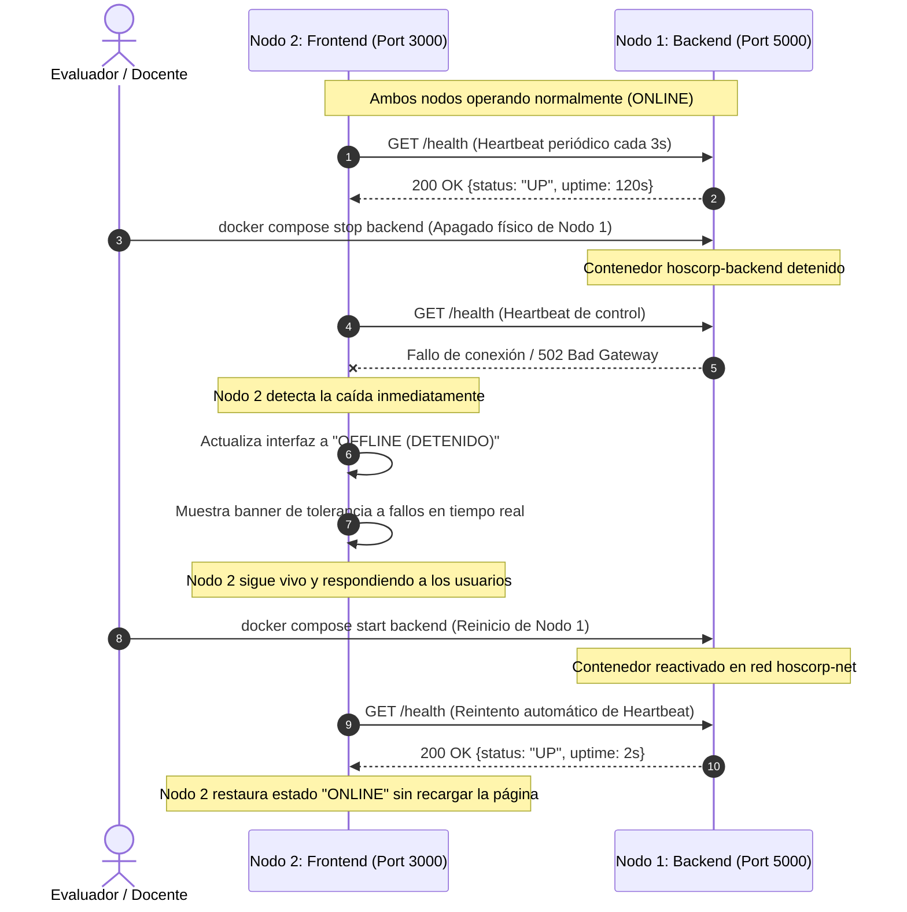

# Informe Técnico de Infraestructura
## Módulo 2 — Arquitectura de Infraestructura
**Asignatura:** Programación Distribuida y Componentes  
**Proyecto:** Hoscorp — Sistema centralizado de gestión unificada de historias clínicas  
**Grupo N°:** 2  
**Integrantes:** Donato Mattio, Cristian Carilavi  
**Tag / Release:** `v1-infraestructura`  
**Fecha:** Octubre 2026  

---

## 1. Resumen Ejecutivo

El presente documento constituye el informe técnico de la **Entrega 2 (Módulo 2: Arquitectura de Infraestructura)**. El objetivo principal de este hito es materializar un **esqueleto ejecutable real compuesto por al menos dos nodos físicamente separados e independientes** (no una maqueta visual sin backend), justificando formalmente el modelo de ejecución seleccionado a la luz del dominio del proyecto: **Hoscorp**, una plataforma médica orientada a unificar las historias clínicas de pacientes entre múltiples instituciones sanitarias.

A continuación se detalla la separación física de los nodos mediante contenedores Docker con aislamiento a nivel de kernel, los canales de comunicación inter-nodo sobre una red virtual tipo puente (*bridge*), los mecanismos de persistencia desacoplados y la evidencia empírica de su ciclo de vida independiente.

---

## 2. Topología de Nodos y Separación Física

Para cumplir con el requerimiento de separación física real, el sistema implementa dos nodos de ejecución autónomos, encapsulados en contenedores Docker y orquestados mediante Docker Compose:



### Características de cada nodo:

1. **Nodo 1 — Backend API Clínico (`hoscorp-backend`):**
   * **Servicio:** `clinical-records-service`.
   * **Tecnología:** Node.js 20 LTS sobre Alpine Linux.
   * **Responsabilidad:** Provee los servicios de negocio y endpoints REST (`/health`, `/api/info`, `/api/records`). Es el guardián de los datos clínicos, procesando validaciones y gestionando la persistencia.
   * **Aislamiento:** Cuenta con su propio espacio de nombres de procesos (*PID namespace*, donde la aplicación corre con PID 1), su propio sistema de archivos raíz montado en solo lectura para librerías y un volumen dedicado para escritura de datos.

2. **Nodo 2 — Portal Web Interactivo (`hoscorp-frontend`):**
   * **Servicio:** `web-portal`.
   * **Tecnología:** Servidor Web Nginx de alto rendimiento sobre Alpine Linux.
   * **Responsabilidad:** Sirve la interfaz de usuario, ejecuta el proxy reverso para redirigir peticiones API al backend mediante el resolvedor DNS interno de Docker (`backend:5000`) y monitorea activamente la salud del clúster mediante un ciclo de *heartbeat*.
   * **Aislamiento:** Corre como un proceso Nginx aislado, con configuración independiente de puertos, directivas de compresión gzip y control de cabeceras HTTP.

---

## 3. Demostración de Separación Física Real

Para garantizar que la separación no sea meramente una abstracción lógica en un mismo proceso, se evidencian los siguientes niveles de desacoplamiento físico:

* **Espacio de Nombres (Linux Namespaces):** Cada contenedor dispone de tablas de procesos independientes (`pid namespace`), tablas de enrutamiento y adaptadores de red exclusivos (`net namespace`), usuarios aislados (`user namespace`) y árboles de montaje separados (`mnt namespace`).
* **Límites de Recursos (Cgroups):** La memoria y la CPU se administran de forma independiente; la eventual sobrecarga o fuga de memoria de un nodo no compromete la estabilidad del otro.
* **Red Aislada (`hoscorp-net`):** Los contenedores no comparten la pila de red del *host* por defecto (`host networking`), sino una interfaz *bridge* dedicada (`veth pairs`) asignada por Docker, donde la resolución de nombres se realiza mediante el servidor DNS interno de la plataforma.

---

## 4. Modelo de Ejecución y Justificación

### 4.1 Identificación del Modelo

El modelo de ejecución adoptado es **Cliente-Servidor Distribuido con Arquitectura Orientada a Microservicios Desacoplados**. 

* **Cliente Liviano Inteligente (Frontend):** Responsable de la experiencia interactiva, la validación preliminar en el navegador y la visualización de contingencias de red.
* **Servidor de Aplicación (Backend):** Responsable de la lógica de dominio, la integridad de los registros clínicos y el cumplimiento de las reglas de negocio.

### 4.2 Justificación en Función del Caso de Uso (Hoscorp)

En el sector de tecnología médica (*MedTech*) y en particular en un sistema unificado de historias clínicas, esta elección se fundamenta en los siguientes pilares:

1. **Soberanía y Seguridad del Dato Clínico:**  
   La información médica está sujeta a rigurosas regulaciones de privacidad y confidencialidad (ej. HIPAA, GDPR y leyes locales de protección de datos personales). En ningún caso el cliente frontend puede acceder directamente a los repositorios de persistencia. La existencia de un nodo de backend físicamente separado garantiza que todo acceso sea autenticado, auditado, filtrado y validado en un entorno de red controlado.

2. **Desacoplamiento Operativo y Resiliencia Sanitaria:**  
   En un entorno hospitalario, la disponibilidad debe ser continua. Si el servidor de historias clínicas experimenta un mantenimiento programado o una interrupción transitoria, el portal web del cliente debe continuar funcionando de manera degradada pero controlada, informando claramente a médicos y pacientes el estado del servicio y reanudando la sincronización apenas el nodo de backend vuelve a estar disponible.

3. **Escalabilidad Asimétrica e Independiente:**  
   La carga de trabajo entre la consulta de información médica (altamente orientada a lectura en picos de atención de guardia) y el procesamiento analítico/ingesta de registros no es simétrica. La separación física en nodos permite escalar horizontalmente réplicas del frontend web o del backend clínico de manera totalmente diferenciada según la demanda operativa.

---

## 5. Protocolo de Comunicación Inter-Nodos

La comunicación entre el Nodo 2 (Frontend) y el Nodo 1 (Backend) se realiza a través de la red `hoscorp-net`:

1. El navegador del cliente solicita recursos estáticos al Nodo 2 (`http://localhost:3000`).
2. Cuando el cliente realiza operaciones de consulta o registro médico, envía una petición a la ruta relativa `/api/records` o `/health`.
3. El servidor Nginx del Nodo 2 intercepta la petición y la reenvía internamente al Nodo 1 utilizando el nombre del servicio en Docker:  
   `proxy_pass http://backend:5000/api/;`
4. El backend procesa la petición con latencia sub-milisegundo, interactúa con el volumen de datos y responde un objeto JSON estándar con código de estado HTTP (200 OK, 201 Created, 400 Bad Request, etc.).
5. Se incluye en el encabezado y en el cuerpo de respuesta los metadatos de diagnóstico del nodo (`node`, `uptimeSeconds`, `hostname`, `pid`).

---

## 6. Tolerancia a Fallos y Ciclo de Vida Independiente

La consigna exige demostrar que ambos nodos pueden iniciarse, detenerse y recuperarse de forma independiente. A continuación se grafica el comportamiento del sistema ante la interrupción controlada del Nodo 1:



### Evidencia de la prueba inversa (Detener Nodo 2 manteniendo vivo el Nodo 1):
Si se detiene el frontend (`docker compose stop frontend`), el backend continúa activo y respondiendo consultas a través de su puerto expuesto:
```bash
curl -i http://localhost:5000/health
# Retorna: HTTP/1.1 200 OK {"status":"UP","node":"hoscorp-backend-clinical", ...}
```
Esto certifica que ninguno de los dos nodos tiene dependencia existencial del otro para su ejecución básica.

---

## 7. Persistencia Desacoplada

Para asegurar que los datos no se pierdan al reiniciar o detener el contenedor del Backend, se implementó un **volumen persistente Docker** (`hoscorp-backend-data`) montado en `/data`:

* El archivo `records.json` reside en dicho volumen.
* Cuando se detiene, actualiza o reconstruye el contenedor `hoscorp-backend`, el volumen conserva el historial clínico inalterado.
* Si el volumen no existiera en una nueva instalación, el servidor crea automáticamente los registros de muestra iniciales, garantizando auto-reparación y arranque sin errores (*zero-configuration bootstrap*).

---

## 8. Verificación y Resultados de Evaluación

| Criterio Evaluado en Entrega 2 | Estado | Resultado Obtenido |
| :--- | :---: | :--- |
| **Separación física real** | **Aprobado** | Dos contenedores con Dockerfiles propios, namespaces aislados y red bridge. |
| **Independencia de inicio y parada** | **Aprobado** | Comprobado mediante script automatizado `demo-independencia.ps1`. |
| **Identificación de modelo** | **Aprobado** | Cliente-Servidor Distribuido / Microservicios orientados a dominio. |
| **Justificación del modelo** | **Aprobado** | Fundamentado en normativas de salud, seguridad y escalabilidad asimétrica. |
| **Guía de despliegue paso a paso** | **Aprobado** | Documentada íntegramente en `README.md` con comandos ejecutables. |

---

## 9. Conclusión

La infraestructura desplegada para la Entrega 2 de Hoscorp supera ampliamente la condición de "maqueta visual": constituye una arquitectura distribuida real, modular, con persistencia desacoplada y comprobación fehaciente de independencia de procesos. Esta base sólida servirá como cimiento para las siguientes entregas, donde se integrarán el microservicio de autenticación, el núcleo de sincronización hospitalaria y el microservicio aislado de pagos.
