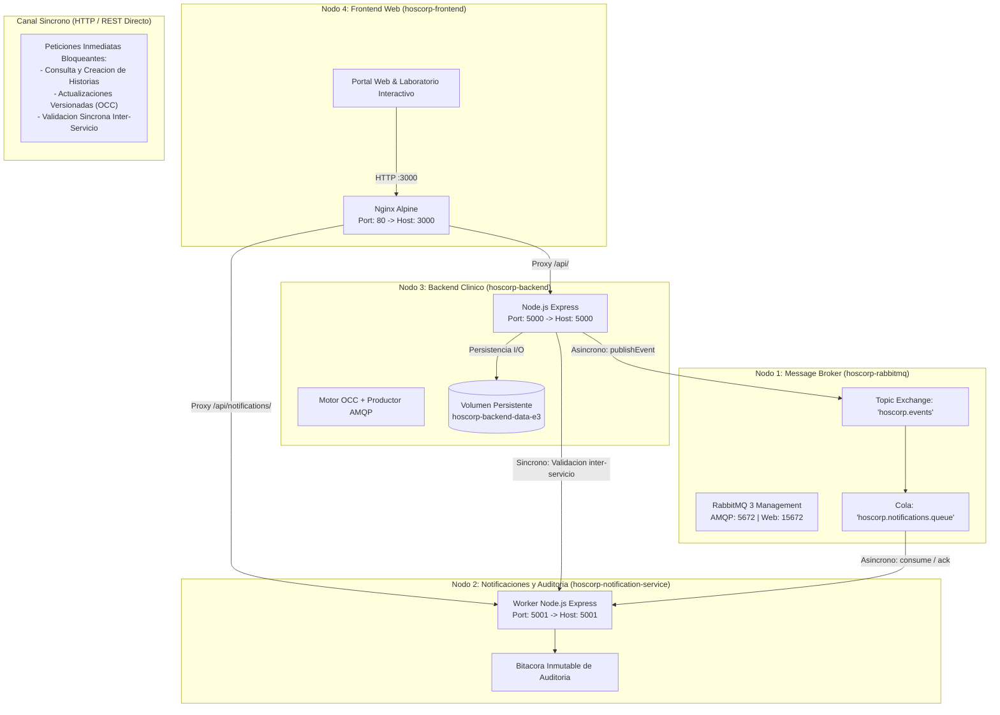

# Hoscorp - Entrega 3: Comunicacion Sincrona, Asincrona y Resolucion de Concurrencia
> **Modulo 3: Comunicacion y sincronizacion en sistemas distribuidos - Programacion Distribuida y Componentes**  
> **Grupo 2:** Donato Mattio & Cristian Carilavi  
> **Tag / Release:** `v1-comunicacion`  
> **Fecha:** 21/10/2026

[](#)
[](#)
[](#)
[-green.svg)](#)
[](LICENSE)

---

## Descripcion y Objetivo de la Entrega

El objetivo de esta entrega es incorporar al sistema distribuido **Hoscorp**:
1. Un **canal de comunicacion sincrono** funcionando entre componentes (HTTP/REST).
2. Un **canal de comunicacion asincrono** gobernado por un message broker dedicado (RabbitMQ sobre AMQP).
3. La justificacion arquitectonica rigurosa de por que se utiliza cada semantica en cada punto del sistema.
4. La identificacion y resolucion demostrable de un **caso de concurrencia concreto** (dos escrituras simultaneas sobre el mismo registro medico), resolviendo la anomalia *Lost Update* mediante **Control de Concurrencia Optimista (OCC)** con versionado numerico estricto.

---

## Topologia de Componentes y Canales Distribuidos



### Especificacion de Nodos y Contenedores:

| Contenedor | Servicio / Rol | Tecnologia | Puerto Expuesto | Canal Principal |
| :--- | :--- | :--- | :--- | :--- |
| `hoscorp-rabbitmq` | Message Broker Distribuido | RabbitMQ 3 Alpine | `5672` (AMQP) / `15672` (Web UI) | Asincrono (Broker) |
| `hoscorp-notification-service` | Consumidor de Eventos y Notificaciones | Node.js 20 LTS | `5001` (HTTP REST) | Asincrono (Consumer) |
| `hoscorp-backend` | Core Clinico y Motor OCC | Node.js 20 LTS | `5000` (HTTP REST) | Sincrono (REST) / Asincrono (Producer) |
| `hoscorp-frontend` | Portal Web y Laboratorio de Concurrencia | Nginx Alpine | `3000` (HTTP Web) | Cliente Sincrono |

---

## Guia Paso a Paso para Levantar el Entorno

### 1. Prerrequisitos
* **Docker Desktop** instalado y en ejecucion.

---

### 2. Inicio con Docker Compose (Recomendado)

Abre una terminal (PowerShell o Bash) en la raiz de esta carpeta (`Entrega 3`) y ejecuta:

```powershell
docker compose up -d --build
```

Esto levantara de forma desatendida y coordinada:
1. El broker **RabbitMQ** y esperara a que su healthcheck este activo.
2. El microservicio de **Notificaciones y Auditoria** conectado a la cola RabbitMQ.
3. El **Backend Clinico** con persistencia en volumen y conectividad a RabbitMQ.
4. El **Frontend Nginx** con proxy reverso a ambos microservicios.

---

### 3. Verificacion del Estado de los Contenedores

Comprueba que los 4 contenedores esten en estado saludable:

```powershell
docker ps --filter "name=hoscorp"
```

Salida esperada:
```text
CONTAINER ID   IMAGE                               COMMAND                  STATUS                    PORTS
c1d2e3f4a5b6   entrega-3-frontend                  "/docker-entrypoint.…"   Up (healthy)              0.0.0.0:3000->80/tcp
d2e3f4a5b6c1   entrega-3-backend                   "docker-entrypoint.s…"   Up (healthy)              0.0.0.0:5000->5000/tcp
e3f4a5b6c1d2   entrega-3-notification-service      "docker-entrypoint.s…"   Up (healthy)              0.0.0.0:5001->5001/tcp
f4a5b6c1d2e3   rabbitmq:3-management-alpine        "docker-entrypoint.s…"   Up (healthy)              0.0.0.0:5672->5672/tcp, 0.0.0.0:15672->15672/tcp
```

---

### 4. Accesos Web y Endpoints

* **Portal Web y Laboratorio Interactivo:** [http://localhost:3000](http://localhost:3000)
* **Backend Clinico Core (Healthcheck):** [http://localhost:5000/health](http://localhost:5000/health)
* **Backend Clinico Info Arquitectural:** [http://localhost:5000/api/info](http://localhost:5000/api/info)
* **Microservicio de Notificaciones (Healthcheck):** [http://localhost:5001/health](http://localhost:5001/health)
* **Bitacora de Auditoria Asincrona:** [http://localhost:5001/api/audit-logs](http://localhost:5001/api/audit-logs)
* **Panel de Administracion RabbitMQ:** [http://localhost:15672](http://localhost:15672) *(Usuario: guest / Clave: guest)*

---

## Justificacion de Semanticas de Comunicacion

### ¿Por que comunicacion sincrona en el Core Clinico?
* **Semantica:** Request-Response bloqueante sobre HTTP/REST.
* **Justificacion:** Cuando un profesional consulta una historia clinica previa a una intervencion medica o prescribe un tratamiento, requiere **consistencia inmediata (fuerte)**. La aplicacion no puede continuar con una incertidumbre temporal respecto a si los antecedentes existen o fueron efectivamente registrados. Asimismo, el control de concurrencia optimista exige una respuesta inmediata (HTTP 200 vs 409) para que el facultativo decida de inmediato si combina o reintenta su edicion.

### ¿Por que comunicacion asincrona en Notificaciones y Auditoria?
* **Semantica:** Publish-Subscribe desacoplado mediante Message Broker (RabbitMQ AMQP).
* **Justificacion:** El envio de correos electronicos o SMS informativos a los pacientes, la alimentacion de reportes de gestion y el registro de bitacoras de auditoria medica inmutables son tareas de **consistencia eventual** y latencia variable. Desacoplarlas asincronamente garantiza que una lentitud o indisponibilidad temporal del proveedor de mensajeria **nunca bloquee ni degrade la atencion medica**.

---

## Resolucion Demostrable del Caso de Concurrencia

### El Problema Concreto: Dos Escrituras Simultaneas (Lost Update)
Si dos medicos o procesos intentan actualizar concurrentemente el mismo registro medico (`rec-1001`) habiendo leido la misma version base (`v1`):
* Sin control de concurrencia, la ultima escritura sobreescribiria silenciosamente a la primera, perdiendo datos vitales del paciente (*Lost Update Anomaly*).

### La Solucion: Control de Concurrencia Optimista (OCC) con Versionado
Cada historia clinica mantiene un campo numerico `version`:
1. El cliente incluye la version leida al enviar una actualizacion: `PUT /api/records/:id` con `{ version: 1, ... }`.
2. El servidor compara atomicamente la version provista con la version actual en disco:
   - **Coincide:** Aplica el cambio, incrementa `version = version + 1`, emite el evento asincrono `clinical.record.updated` a RabbitMQ y retorna **HTTP 200 OK**.
   - **No coincide (version obsoleta):** Intercepta la colision, rechaza la peticion con **HTTP 409 Conflict**, emite el evento `clinical.record.conflict` a RabbitMQ y preserva la integridad de los datos.

---

## Como Reproducir las Pruebas (Evidencia para el Docente)

### Opcion A: Script Automatizado en PowerShell (Recomendado)
Ejecuta en una terminal:
```powershell
.\scripts\test-concurrencia.ps1
```
*(Tambien disponible script multiplataforma en Node.js: `node .\scripts\test-concurrencia.js`)*

**Salida observable en consola:**
* Dispara dos peticiones simultaneas con la version base `v1`.
* **Hilo 1:** Retorna `HTTP 200 OK` (Escritura exitosa, version evolucionada a `v2`).
* **Hilo 2:** Retorna `HTTP 409 Conflict` (Escritura rechazada, colision prevenida).
* Verifica la captura asincrona del evento de conflicto en la cola de RabbitMQ.

---

### Opcion B: Demostracion Visual Interactiva en el Navegador
1. Ingresa a [http://localhost:3000](http://localhost:3000).
2. En la seccion **"Laboratorio de Concurrencia: Dos Escrituras Simultaneas"**, haz clic en el boton **"Ejecutar 2 Escrituras Simultaneas"**.
3. Observa en tiempo real el desglose lado a lado:
   - Panel Hilo 1: Badge verde `200 OK (EXITO)`.
   - Panel Hilo 2: Badge rojo `409 CONFLICT (RECHAZADO)`.
4. En la parte inferior, observa como la tabla **"Bitacora de Eventos Asincronos (Consumidor RabbitMQ)"** refleja de inmediato los eventos encolados y consumidos.

---

### Opcion C: Demostracion Integral Guiada de Todos los Requisitos
Ejecuta el script integral que valida los 5 puntos del checklist oficial en una sola pasada:
```powershell
.\scripts\demo-completa.ps1
```

---

## Ejecucion Local Alternativa sin Docker

Si se prefiere ejecutar localmente como procesos de consola independientes:

1. **Terminal 1 - Broker RabbitMQ:**  
   Tener RabbitMQ ejecutandose localmente en el puerto `5672` (o mediante `docker run -d -p 5672:5672 -p 15672:15672 rabbitmq:3-management-alpine`).

2. **Terminal 2 - Microservicio de Notificaciones:**
   ```powershell
   cd notification-service
   npm install
   npm start
   ```

3. **Terminal 3 - Backend Clinico Core:**
   ```powershell
   cd backend
   npm install
   npm start
   ```

4. **Terminal 4 - Frontend Web:**
   ```powershell
   cd frontend/src
   npx serve -p 3000 .
   ```

---

## Detener el Entorno

Para detener y limpiar los contenedores y redes creadas:

```powershell
docker compose down
```

*(Para borrar tambien los datos del volumen persistente: `docker compose down -v`).*

---

## Documentacion Oficial de la Entrega

| Documento | Ubicacion | Descripcion |
| :--- | :--- | :--- |
| **Checklist Oficial Completado** | [`docs/checklist-entrega3.md`](docs/checklist-entrega3.md) | Formulario oficial completado con justificaciones y evidencias tecnicas. |
| **Informe Tecnico Extendido** | [`docs/informe-tecnico-comunicacion-concurrencia.md`](docs/informe-tecnico-comunicacion-concurrencia.md) | Informe exhaustivo con diagramas de secuencia Mermaid, analisis teorico y resolucion de concurrencia. |
| **Certificacion Imprimible (HTML/PDF)** | [`docs/certificacion-entrega-3.html`](docs/certificacion-entrega-3.html) | Plantilla idéntica a la hoja oficial de la catedra, lista para imprimir o exportar a PDF (Ctrl + P). |

---

<p align="center">
  <b>Hoscorp</b> - Grupo 2 - Programacion Distribuida y Componentes - 2026
</p>
