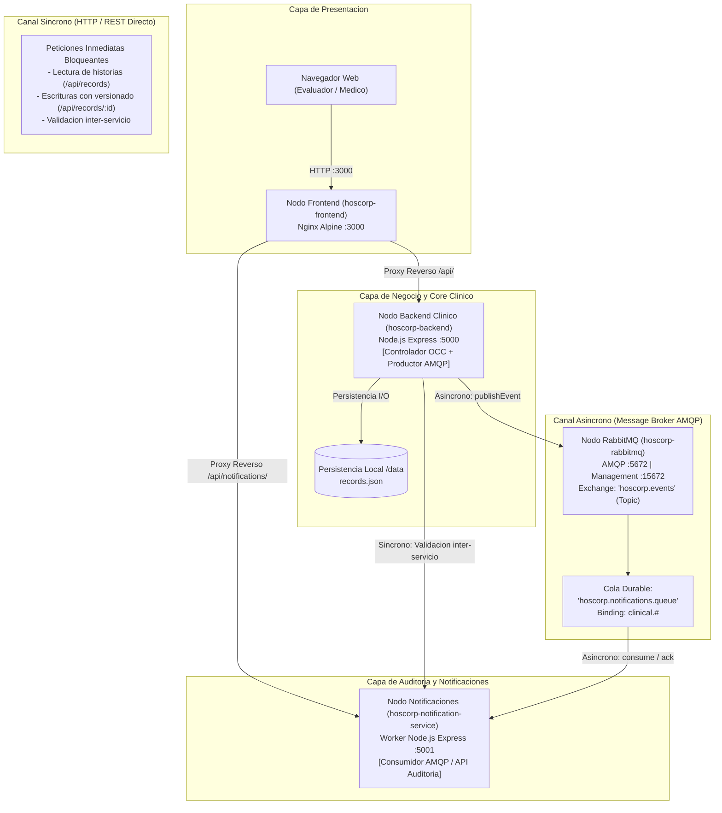
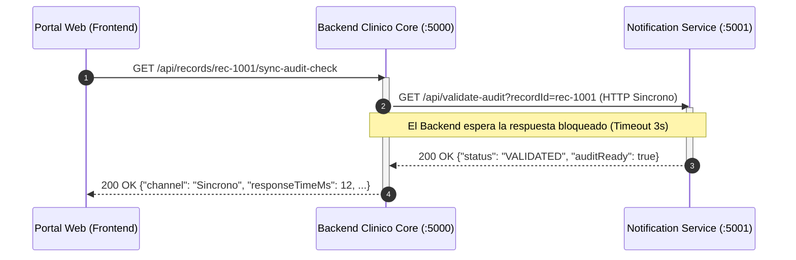
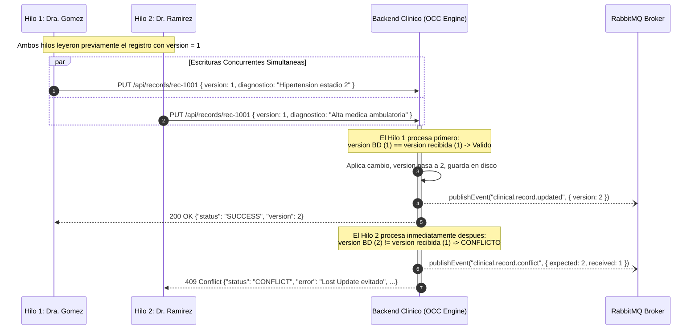

# Informe Tecnico: Comunicacion Sincrona, Asincrona y Resolucion de Concurrencia
**Modulo 3: Comunicacion y sincronizacion en sistemas distribuidos**  
**Proyecto:** Hoscorp - Gestion Unificada de Historias Clinicas  
**Grupo 2:** Donato Mattio & Cristian Carilavi  
**Tag / Release:** `v1-comunicacion`  
**Fecha:** 21/10/2026

---

## 1. Introduccion y Contexto

En el marco de la arquitectura distribuida de **Hoscorp**, la comunicacion entre componentes y la preservacion de la consistencia de los datos clinicos constituyen pilares fundamentales. Un sistema de historias clinicas no puede operar de forma aislada ni bajo un unico paradigma monolitico: interactua con portales web de pacientes, interfaces de profesionales de la salud, microservicios internos de negocio y sistemas de informacion hospitalaria externos (HIS/EMR).

El presente informe formaliza y documenta la implementacion correspondiente a la **Entrega 3**, cuyo alcance comprende:
1. La incorporacion y puesta en marcha de un **canal de comunicacion sincrono**.
2. La incorporacion y puesta en marcha de un **canal de comunicacion asincrono** gobernado por un message broker dedicado.
3. La justificacion arquitectonica rigurosa de la semantica elegida para cada punto critico del sistema.
4. La identificacion y modelado de un **caso concreto de concurrencia** (escrituras simultaneas sobre el mismo registro clinico).
5. La resolucion demostrable mediante **Control de Concurrencia Optimista (OCC)**, acompanada de scripts y herramientas interactivas de verificacion empirica.

---

## 2. Topologia y Arquitectura de Canales Distribuidos

A fin de satisfacer los principios de desacoplamiento y resiliencia, el sistema distribuye sus responsabilidades en cuatro nodos ejecutados en contenedores independientes interconectados por una red puente (*bridge network*):



---

## 3. Especificacion de los Canales de Comunicacion

### 3.1 Canal Sincrono: HTTP / REST

#### Definicion y Semantica
La comunicacion sincrona impone un **acoplamiento temporal estricto** entre emisor y receptor: el emisor emite una solicitud (*request*), suspende su hilo de ejecucion y aguarda de forma bloqueante la respuesta (*response*) o el agotamiento del tiempo limite (*timeout*). Ambos extremos deben estar disponibles en el instante exacto de la interaccion.

#### Puntos de Aplicacion en Hoscorp
1. **Frontend -> Backend Clinico (`GET /api/records`):** Consulta de lectura inmediata de historias clinicas unificadas. El profesional requiere visualizar los antecedentes clinicos en tiempo real antes de efectuar una prescripcion.
2. **Frontend -> Backend Clinico (`PUT /api/records/:id` con OCC):** Modificacion clinica transaccional. El cliente necesita certeza inmediata de si el guardado fue exitoso (HTTP 200) o si colisiono con otra modificacion (HTTP 409).
3. **Backend Clinico -> Microservicio de Notificaciones (`GET /api/records/:id/sync-audit-check`):** Llamada directa inter-servicio para verificar la disponibilidad del subsistema de auditoria previo a operaciones restringidas.

#### Diagrama de Secuencia: Canal Sincrono Inter-Servicio



---

### 3.2 Canal Asincrono: RabbitMQ (AMQP)

#### Definicion y Semantica
La comunicacion asincrona desacopla a los componentes tanto en el **tiempo** como en el **espacio**. El emisor (*producer*) construye el mensaje, lo deposita en el intermediario (*message broker*) y continua su ejecucion de inmediato sin esperar el procesamiento final. El receptor (*consumer*) obtiene el mensaje cuando dispone de capacidad de computo, implementando tolerancia a fallos mediante acuses de recibo (*acknowledgments*).

#### Puntos de Aplicacion en Hoscorp
1. **Emision de Eventos Clinicos (`clinical.record.created`, `clinical.record.updated`):** Notificaciones al paciente por correo/SMS sobre nuevos diagnosticos o estudios.
2. **Registro Inmutable de Auditoria Medica:** Trazabilidad de accesos y modificaciones en segundo plano sin ralentizar la respuesta operativa al medico.
3. **Alertas de Seguridad ante Conflictos (`clinical.record.conflict`):** Cuando se detecta un intento de colision concurrente, se despacha un evento al broker para que el equipo de ciberseguridad y auditoria registre el incidente.

#### Diagrama de Secuencia: Canal Asincrono mediante Message Broker

```mermaid
sequenceDiagram
    autonumber
    participant Medico as Medico (Cliente HTTP)
    participant Backend as Backend Clinico (Producer)
    participant Broker as RabbitMQ Exchange ("hoscorp.events")
    participant Cola as Cola "hoscorp.notifications.queue"
    participant Worker as Notification Service (Consumer)

    Medico->>Backend: POST /api/records (Crear historia clinica)
    activate Backend
    Backend->>Backend: Persiste registro en disco (V=1)
    Backend->)Broker: publishEvent("clinical.record.created", payload)
    Note over Backend,Broker: Publicacion no bloqueante (Fire-and-Forget / AMQP)
    Backend-->>Medico: 201 Created (Respuesta inmediata al medico)
    deactivate Backend

    Broker->>Cola: Enruta mensaje segun RoutingKey "clinical.#"
    activate Worker
    Cola->>Worker: Consume mensaje (Push)
    Worker->>Worker: Registra evento en bitacora inmutable
    Worker->>Worker: Simula envio de email de alerta al paciente
    Worker-->>Cola: ACK (Mensaje procesado con exito)
    deactivate Worker
```

---

## 4. Cuadro Comparativo y Justificacion de Semanticas

| Criterio | Canal Sincrono (HTTP/REST) | Canal Asincrono (RabbitMQ / AMQP) |
| :--- | :--- | :--- |
| **Mecanismo de Enlace** | Acoplamiento temporal estricto (ambos deben estar vivos). | Desacoplamiento temporal completo (el broker retiene mensajes). |
| **Impacto en Latencia** | La latencia es la suma de la red y el procesamiento del receptor. | Latencia nula para el emisor tras la confirmacion local de encolado. |
| **Resiliencia ante Caidas** | Si el receptor cae, la peticion falla inmediatamente (503/Timeout). | Si el consumidor cae, los mensajes quedan retenidos en cola sin perderse. |
| **Consistencia** | Inmediata (fuerte) en el ciclo de solicitud. | Eventual en los consumidores secundarios. |
| **Justificacion en Hoscorp** | **Obligatorio para la atencion clinica en vivo:** Un medico no puede tolerar no saber si su diagnostico quedo asentado o si el registro existe en la base de datos. | **Obligatorio para tareas secundarias y notificaciones:** El envio de un SMS o la generacion de un reporte de auditoria no debe bloquear la consulta medica. |

---

## 5. El Caso de Concurrencia: Dos Escrituras Simultaneas

### 5.1 Identificacion de la Anomalia (Lost Update)

En entornos de salud interconectados, multiples actores interactuan simultaneamente sobre las mismas entidades:
- Dos profesionales de diferentes especialidades consultando al mismo paciente en el mismo momento.
- Un proceso de sincronizacion automatica de un hospital externo ingresando datos mientras un medico redacta una observacion manual en el portal.

Supongamos que el registro clinico `rec-1001` (Carlos Gomez) se encuentra en la **version 1**:
1. El **Hilo 1 (Dra. Gomez)** lee `rec-1001` (Version 1).
2. El **Hilo 2 (Dr. Ramirez)** lee `rec-1001` (Version 1).
3. El Hilo 1 actualiza el diagnostico e intenta guardar.
4. El Hilo 2 actualiza las indicaciones farmacologicas e intenta guardar.

**Sin control de concurrencia:** El Hilo 2 sobreescribiria ciegamente la modificacion del Hilo 1. La intervencion de la Dra. Gomez se perderia de forma silenciosa e irrecuperable (*Lost Update Anomaly*), representando un riesgo critico de mala praxis.

---

### 5.2 Evaluacion de Soluciones: ¿Por que Optimistic Locking (OCC)?

| Estrategia | Evaluacion en Sistemas Web Distribuidos |
| :--- | :--- |
| **Bloqueo Pesimista (*Pessimistic Locking / SELECT FOR UPDATE*)** | Inadecuado para aplicaciones web sin estado (*stateless*). Retiene bloqueos en la base de datos mientras el usuario humano lee o edita en pantalla, generando agotamiento de conexiones, cuellos de botella masivos y alto riesgo de interbloqueos (*deadlocks*). |
| **Control de Concurrencia Optimista (*OCC*) [Elegida]** | **Optima.** Asume que las colisiones son infrecuentes pero criticas. No bloquea lecturas concurrentes. Cada registro mantiene un atributo numerico `version`. Al escribir, se valida atomicamente que la version provista sea igual a la actual en disco. Si coincide, se aplica y se incrementa (`version = version + 1`). Si no coincide, se rechaza inmediatamente con **HTTP 409 Conflict**. |

---

### 5.3 Algoritmo de Resolucion OCC



---

## 6. Guia de Reproduccion y Evidencia Demostrable

Para acreditar de forma empirica ante la catedra que la solucion esta efectivamente implementada y operativa, se disponen dos modalidades:

### Modalidad A: Verificacion Automatizada por Consola (CLI)
1. Iniciar los contenedores:
   ```powershell
   docker compose up -d --build
   ```
2. Ejecutar el script automatizado:
   ```powershell
   .\scripts\test-concurrencia.ps1
   ```
   *(O alternativamente: `node .\scripts\test-concurrencia.js`)*
3. **Salida esperada:**
   - Hilo 1: HTTP 200 OK con incremento de version a `2`.
   - Hilo 2: HTTP 409 Conflict con cuerpo explicativo de version obsoleta.
   - Verificacion de evento `clinical.record.conflict` en la cola RabbitMQ.

### Modalidad B: Verificacion Interactiva desde el Portal Web (UI)
1. Acceder a [http://localhost:3000](http://localhost:3000).
2. Constatar que los 4 nodos estan marcados con el badge verde `ONLINE`.
3. En la seccion **"Laboratorio de Concurrencia: Dos Escrituras Simultaneas"**, presionar el boton **"Ejecutar 2 Escrituras Simultaneas"**.
4. Observar en tiempo real la division de paneles: el Hilo 1 exhibe el resultado exitoso (200 OK) y el Hilo 2 exhibe el rechazo preventivo (409 Conflict).
5. Revisar la tabla de **Bitacora de Eventos Asincronos (RabbitMQ)** al pie de pagina para comprobar la captura del evento.

---

## 7. Conclusiones

La implementacion realizada en esta Entrega 3 demuestra que la seleccion entre semanticas sincronas y asincronas no es arbitraria ni intercambiable, sino que responde a requerimientos no funcionales de consistencia, latencia y tolerancia a fallos. La introduccion de RabbitMQ proporciona un desacoplamiento efectivo para tareas accesorias, mientras que el mecanismo de Control de Concurrencia Optimista (OCC) salvaguarda la integridad de las historias clinicas frente a condiciones de carrera reales, satisfaciendo la totalidad de los requisitos fijados por la catedra.
