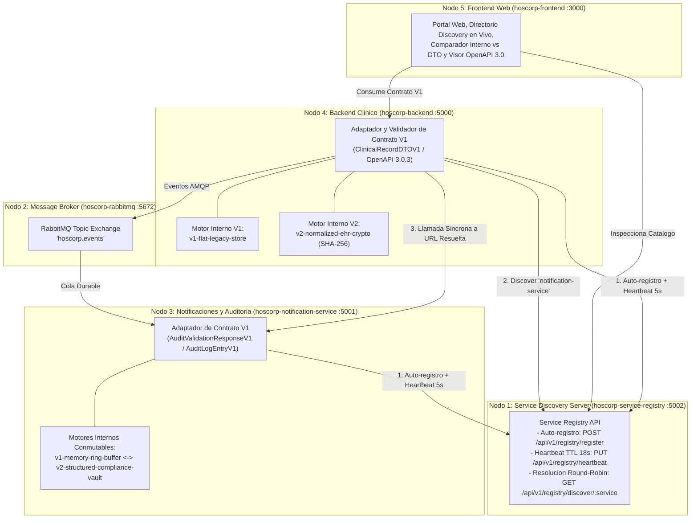

# Hoscorp — Entrega 4: Contratos de Interfaz y Descubrimiento de Servicios
> **Modulo 4: Middleware y componentes distribuidos · Programacion Distribuida y Componentes**  
> **Grupo 2:** Donato Mattio & Cristian Carilavi  
> **Tag / Release:** `v1-middleware`  
> **Fecha:** 18/11/2026

[](#)
[](#)
[](#)
[](#)
[](../LICENSE)

---

## Descripcion y Objetivo de la Entrega

El foco de esta cuarta entrega es formalizar y demostrar empiricamente como se comunican los componentes distribuidos de **Hoscorp** sin depender de acuerdos informales ni de configuraciones de red estaticas (*hardcoded*):

1. **Contratos de Interfaz Explicitos (API REST):** Documentados formalmente mediante especificaciones **OpenAPI 3.0.3** (`contracts/*.yaml`), expuestos en tiempo de ejecucion (`GET /api/v1/contract`), acompanados de una **Coleccion Oficial de Postman v2.1** y protegidos por validadores de esquema en runtime que rechazan violaciones con `HTTP 400 CONTRACT_VIOLATION`.
2. **Modificacion Interna sin Romper el Contrato (Patron Contract Adapter / DTO):** Implementacion de motores internos conmutables en caliente (`POST /api/v1/internal/switch-engine`). El componente `clinical-records-service` puede cambiar su arquitectura interna entre **`v1-flat-legacy-store`** (objetos planos) y **`v2-normalized-ehr-crypto`** (arbol jerarquico tipo HL7/FHIR con sello de integridad SHA-256), mientras que el Adaptador de Contrato garantiza que el DTO publico **`ClinicalRecordDTOV1`** permanezca **100% invariante**.
3. **Mecanismo de Descubrimiento de Servicios (`service-registry` :5002):** Microservicio dedicado donde los componentes se **auto-registran** al iniciar (`POST /api/v1/registry/register`), mantienen su estado mediante **Heartbeats cada 5s con control de TTL** y se descubren dinamicamente en tiempo de ejecucion (`GET /api/v1/registry/discover/:serviceName`) con balanceo *Round-Robin*.

---

## Topologia de Middleware, Contratos y Service Discovery



### Especificacion de Nodos y Contratos:

| Contenedor | Servicio Logico | Puerto | Contrato OpenAPI en Vivo | Rol en Entrega 4 |
| :--- | :--- | :--- | :--- | :--- |
| `hoscorp-service-registry` | `service-registry` | `5002` | `http://localhost:5002/api/v1/contract` | Servidor de Descubrimiento de Servicios (Registro, TTL y Lookup) |
| `hoscorp-backend` | `clinical-records-service` | `5000` | `http://localhost:5000/api/v1/contract` | Core Clinico con Adaptador DTO, Hot-Swap V1/V2 y Discovery Client |
| `hoscorp-notification-service` | `notification-service` | `5001` | `http://localhost:5001/api/v1/contract` | Servicio de Auditoria Auto-Registrado con Adaptador de Contrato |
| `hoscorp-rabbitmq` | `rabbitmq-broker` | `5672` / `15672` | Protocolo AMQP 0-9-1 | Broker de Mensajeria Asincrona |
| `hoscorp-frontend` | `web-portal` | `3000` | [http://localhost:3000](http://localhost:3000) | Portal Web, Laboratorio de Desacople y Explorador OpenAPI |

---

## Guia Paso a Paso para Levantar el Entorno

### 1. Inicio con Docker Compose (Recomendado)

Abre una terminal en la carpeta `Entrega 4` y ejecuta:

```powershell
docker compose up -d --build
```

Verifica que los 5 contenedores esten en ejecucion y saludables:

```powershell
docker ps --filter "name=hoscorp"
```

---

## Como Reproducir y Verificar los Requisitos (Evidencia para el Docente)

### Opcion A: Script Automatizado de Certificacion (PowerShell / Node.js)

Ejecuta en tu terminal:

```powershell
.\scripts\test-contratos-discovery.ps1
```
*(O en Node.js multiplataforma: `node .\scripts\test-contratos-discovery.js`)*

**Que verifica este script de forma automatica:**
1. **Contratos Formales:** Consulta `/api/v1/contract` en los puertos `5000`, `5001` y `5002`, validando las especificaciones OpenAPI 3.0.3.
2. **Service Discovery:** Consulta el catalogo en `http://localhost:5002/api/v1/registry/services` y resuelve dinamicamente la direccion de `notification-service` en `GET /api/v1/registry/discover/notification-service`.
3. **Modificacion Interna sin Romper el Contrato:** Captura el DTO publico de `rec-1001` en el Motor Interno V1, ejecuta un *Hot-Swap* al Motor Interno V2 (`POST /api/v1/internal/switch-engine`), y comprueba que el DTO publico devuelto por `/api/v1/records/rec-1001` es **100% identico** a pesar del cambio radical en la estructura interna.
4. **Verificacion de Desacople (Contract Enforcement):** Envia un payload que viola el contrato y verifica que sea rechazado automaticamente con `HTTP 400 CONTRACT_VIOLATION`, seguido de una llamada sincrona inter-servicio resuelta via Service Discovery.

---

### Opcion B: Laboratorio Interactivo en el Portal Web

1. Abre en tu navegador: [http://localhost:3000](http://localhost:3000)
2. En la seccion **"Laboratorio de Contratos de Interfaz y Descubrimiento de Servicios"**:
   * **Directorio en Vivo del Service Registry:** Observa en tiempo real los microservicios auto-registrados, sus Instance IDs, URLs resueltas, motores internos activos, antiguedad del ultimo Heartbeat y cantidad de Lookups.
   * **Boton "Certificar Desacople y Contratos (4 Pruebas)":** Ejecuta la suite completa y despliega el resultado paso a paso junto con la comparacion lado a lado entre la **Estructura Interna Cruda del Componente** y el **Contrato Publico Expuesto (`ClinicalRecordDTOV1`)**.
   * **Boton "Conmutar Motor Interno (Hot-Swap V1 <-> V2)":** Alterna en vivo la arquitectura interna del backend entre objetos planos y el modelo EHR normalizado con SHA-256, comprobando visualmente que el contrato externo no se rompe.
   * **Explorador de Contratos Formales OpenAPI 3.0.3:** Permite inspeccionar en pantalla los contratos JSON completos de cada servicio.

---

## Documentacion de la API y Artefactos de la Entrega

| Artefacto / Documento | Ubicacion | Descripcion |
| :--- | :--- | :--- |
| **Contrato OpenAPI Backend Clinico** | [`contracts/openapi-clinical-records.yaml`](contracts/openapi-clinical-records.yaml) | Especificacion formal OpenAPI 3.0.3 del servicio de historias clinicas. |
| **Contrato OpenAPI Notificaciones** | [`contracts/openapi-notifications.yaml`](contracts/openapi-notifications.yaml) | Especificacion formal OpenAPI 3.0.3 del servicio de auditoria y notificaciones. |
| **Contrato OpenAPI Service Registry** | [`contracts/openapi-service-registry.yaml`](contracts/openapi-service-registry.yaml) | Especificacion formal OpenAPI 3.0.3 del servidor de descubrimiento. |
| **Coleccion de Postman v2.1** | [`contracts/hoscorp-entrega4.postman_collection.json`](contracts/hoscorp-entrega4.postman_collection.json) | Coleccion importable con todas las llamadas de contratos y Service Discovery. |
| **Checklist Oficial Completado** | [`docs/checklist-entrega4.md`](docs/checklist-entrega4.md) | Tabla oficial de requisitos completada con justificaciones y evidencias. |
| **Informe Tecnico Extendido** | [`docs/informe-tecnico-contratos-discovery.md`](docs/informe-tecnico-contratos-discovery.md) | Analisis arquitectonico con diagramas de secuencia Mermaid y patron Adapter. |
| **Certificacion Imprimible (HTML/PDF)** | [`docs/certificacion-entrega-4.html`](docs/certificacion-entrega-4.html) | Plantilla identica al PDF oficial de la catedra lista para imprimir (Ctrl + P). |

---

<p align="center">
  <b>Hoscorp</b> · Grupo 2 · Programacion Distribuida y Componentes · 2026
</p>
