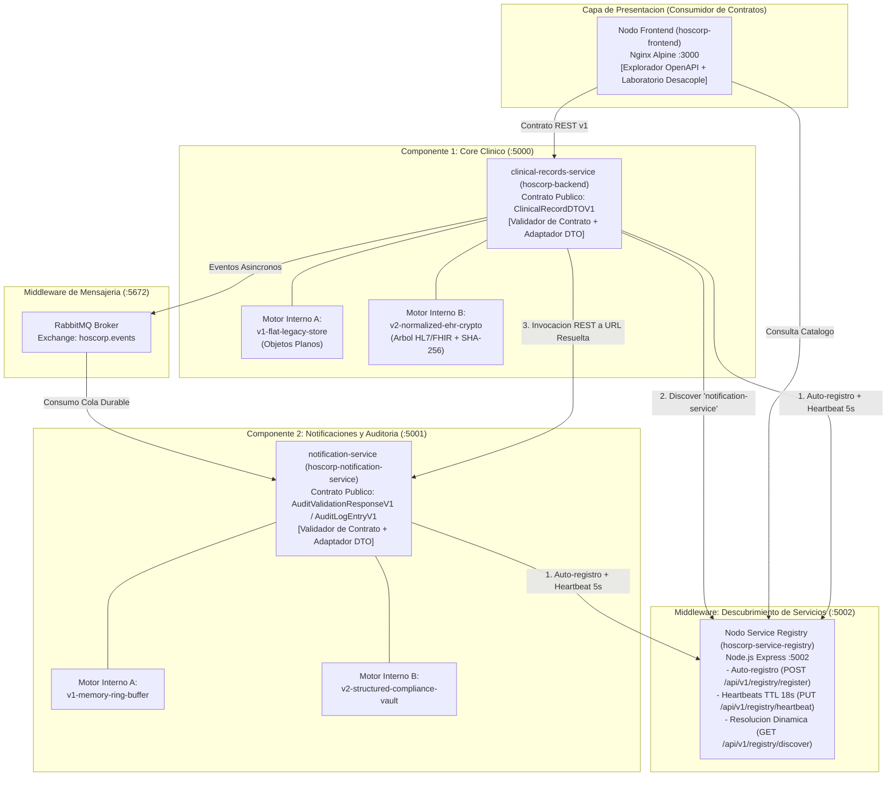
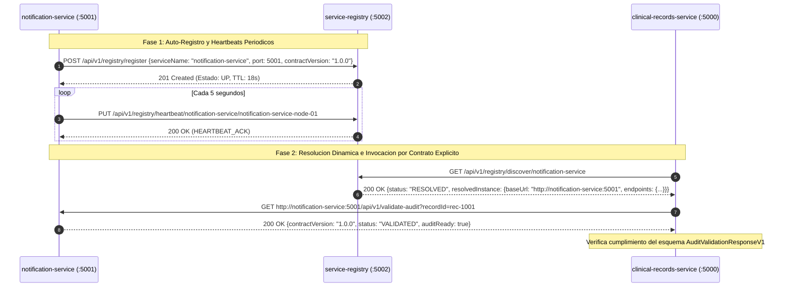

# Informe Tecnico: Contratos de Interfaz Explicitos y Descubrimiento de Servicios
**Modulo 4: Middleware y componentes distribuidos**  
**Proyecto:** Hoscorp - Gestion Unificada de Historias Clinicas  
**Grupo 2:** Donato Mattio & Cristian Carilavi  
**Tag / Release:** `v1-middleware`  
**Fecha:** 18/11/2026

---

## 1. Introduccion y Objetivo del Modulo 4

En un sistema distribuido orientado a microservicios como **Hoscorp**, el acoplamiento accidental entre componentes constituye uno de los mayores riesgos arquitectonicos. Si dos servicios se comunican asumiendo implicitamente la estructura interna de datos del otro o dependiendo de direcciones IP y puertos estaticos codificados de forma rigida (*hardcoded*), cualquier cambio evolutivo en un componente provoca fallas en cascada en el resto del sistema.

El objetivo de esta **Entrega 4** es formalizar y verificar empiricamente el **desacople por contrato explicito y middleware de descubrimiento**:
1. **Formalizacion de Contratos de Interfaz (API REST):** Especificacion rigurosa mediante **OpenAPI 3.0.3** y validacion activa de esquemas en tiempo de ejecucion.
2. **Independencia de Implementacion Interna (Patron Contract Adapter / DTO):** Demostracion en vivo de como cada microservicio puede mutar radicalmente su motor de persistencia y estructura de datos interna sin alterar ni un solo atributo del contrato expuesto hacia los demas.
3. **Mecanismo de Descubrimiento de Servicios (Service Discovery):** Implementacion de un servidor `service-registry` con auto-registro al arranque, monitoreo activo de salud mediante *Heartbeats* con *Time-To-Live (TTL)* y resolucion dinamica de ubicacion con balanceo *Round-Robin*.

---

## 2. Arquitectura de Middleware y Descubrimiento de Servicios

La topologia evoluciona incorporando el nodo **`hoscorp-service-registry` (:5002)** como componente central de middleware para la localizacion dinamica y el catalogo de contratos:



---

## 3. Mecanismo de Descubrimiento de Servicios (Service Discovery)

### 3.1 Ciclo de Vida del Registro y Resolucion Dinamica

Para eliminar las dependencias estaticas, se suprimio la variable `NOTIFICATION_SERVICE_URL` de la configuracion del contenedor `hoscorp-backend`. En su lugar, la comunicacion inter-servicio sigue el patron **Client-Side / Server-Assisted Service Discovery**:

1. **Auto-Registro (*Self-Registration*):** Al iniciar su proceso, tanto `clinical-records-service` como `notification-service` envian una peticion `POST /api/v1/registry/register` al `service-registry` (:5002), declarando su nombre logico (`serviceName`), identificador de instancia (`instanceId`), direccion de red (`host`, `port`), version del contrato (`1.0.0`), motor interno activo y mapa de rutas.
2. **Renovacion por Latido (*Heartbeat & TTL Eviction*):** Cada 5 segundos, cada microservicio emite `PUT /api/v1/registry/heartbeat/:serviceName/:instanceId`. El `service-registry` ejecuta un recolector cada 3 segundos; si una instancia supera su `ttlSeconds` (18 segundos) sin reportar latidos, su estado pasa automaticamente a `DOWN_TTL_EXPIRED` y deja de ser elegible en las resoluciones.
3. **Descubrimiento en Tiempo de Ejecucion (*Dynamic Lookup*):** Cuando `clinical-records-service` debe validar la auditoria de una historia clinica, consulta `GET /api/v1/registry/discover/notification-service`. El registro selecciona una instancia saludable (`status === 'UP'`) aplicando balanceo *Round-Robin* y retorna su `baseUrl` y metadatos de contrato.



---

## 4. Formalizacion de Contratos y Desacople Interno (Patron Adapter/DTO)

### 4.1 Contratos Explicitos OpenAPI 3.0.3

Todos los contratos entre componentes estan formalmente documentados en la carpeta `contracts/` y expuestos en vivo en `/api/v1/contract`:

| Componente | Archivo de Contrato Formal | Endpoint en Vivo | Esquemas Principales (DTOs) |
| :--- | :--- | :--- | :--- |
| **Backend Clinico** | `contracts/openapi-clinical-records.yaml` | `http://localhost:5000/api/v1/contract` | `ClinicalRecordDTOV1`, `ClinicalRecordCreateInputV1`, `ClinicalRecordUpdateInputV1`, `ContractViolationErrorV1` |
| **Notificaciones y Auditoria** | `contracts/openapi-notifications.yaml` | `http://localhost:5001/api/v1/contract` | `AuditValidationResponseV1`, `AuditLogEntryV1`, `AuditLogListResponseV1` |
| **Service Registry** | `contracts/openapi-service-registry.yaml` | `http://localhost:5002/api/v1/contract` | `ServiceRegistrationInputV1`, `ServiceDiscoveryResolutionV1` |

---

### 4.2 Modificacion Interna sin Romper el Contrato (Hot-Swap de Motores)

Para demostrar que **cada componente puede modificarse internamente sin romper el contrato hacia los demas** (y no depender de acuerdos informales entre desarrolladores), se implemento una arquitectura de **Adaptador de Contrato (`ClinicalRecordContractAdapterV1`)** que desacopla la representacion interna respecto del DTO publico.

El componente `clinical-records-service` dispone de dos motores internos radicalmente distintos que pueden alternarse en caliente mediante `POST /api/v1/internal/switch-engine`:

#### Representacion en Motor Interno V1 (`v1-flat-legacy-store`):
```json
{
  "id": "rec-1001",
  "version": 1,
  "paciente": "Carlos Gomez",
  "dni": "32.456.789",
  "fecha": "2026-10-10",
  "centroSalud": "Hospital Central de Cordoba",
  "profesional": "Dra. Sofia Albarracin (Mat. 44521)",
  "diagnostico": "Hipertension arterial estadio 1",
  "observaciones": "Control trimestral de presion.",
  "updatedAt": "2026-10-10T14:30:00.000Z"
}
```

#### Representacion en Motor Interno V2 (`v2-normalized-ehr-crypto`):
```json
{
  "ehr_internal_schema": "HOSCORP-EHR-NORMALIZED-V2",
  "record_meta": {
    "uid": "rec-1001",
    "occ_revision": 1,
    "last_modified_epoch_ms": 1791642600000,
    "sha256_integrity_seal": "e9c0f8b2d1..."
  },
  "subject_demographics": {
    "full_legal_name": "Carlos Gomez",
    "national_identity_doc": "32.456.789"
  },
  "encounter_context": {
    "healthcare_facility_name": "Hospital Central de Cordoba",
    "attending_clinician_ref": "Dra. Sofia Albarracin (Mat. 44521)",
    "encounter_date_iso": "2026-10-10"
  },
  "clinical_assessment": {
    "primary_diagnosis_code_text": "Hipertension arterial estadio 1",
    "treatment_notes_narrative": "Control trimestral de presion."
  }
}
```

**Invarianza del Contrato Exterior:**  
Aunque en el Motor V2 todos los nombres de atributos internos, la jerarquia de objetos, el formato temporal (`epoch_ms` vs `ISO-8601`) y los sellos criptograficos cambian por completo, el adaptador `toPublicContractDTO()` garantiza que cualquier consumidor que invoque `GET /api/v1/records` o `PUT /api/v1/records/:id` reciba **exactamente el mismo esquema `ClinicalRecordDTOV1`**.

Del mismo modo, `notification-service` permite alternar en caliente su motor interno entre `v1-memory-ring-buffer` y `v2-structured-compliance-vault` (con clasificacion ISO/IEC 27799) manteniendo inalterado el contrato `AuditLogEntryV1`.

---

## 5. Guia de Reproduccion de las Pruebas de Desacople

### Metodo 1: Script Automatizado de Certificacion por Consola
Ejecutar desde la raiz de `Entrega 4`:
```powershell
.\scripts\test-contratos-discovery.ps1
```
*(O en Node.js multiplataforma: `node .\scripts\test-contratos-discovery.js`)*

El script verifica automaticamente:
1. La publicacion y validez de los 3 contratos OpenAPI 3.0.3 (`/api/v1/contract`).
2. El auto-registro de los servicios y la resolucion dinamica de `notification-service` en el puerto `5002`.
3. La conmutacion en caliente del motor interno de V1 a V2, comprobando matematicamente que el JSON del contrato publico antes y despues del cambio es **100% identico**.
4. El rechazo automatico con `HTTP 400 CONTRACT_VIOLATION` ante un payload que infringe el contrato.
5. La invocacion sincrona inter-servicio resuelta via Service Discovery.

### Metodo 2: Laboratorio Interactivo en el Portal Web
1. Abrir [http://localhost:3000](http://localhost:3000).
2. En la seccion **"Laboratorio de Contratos de Interfaz y Descubrimiento de Servicios"**:
   * Observar la tabla del **Directorio en Vivo del Service Registry** con las instancias auto-registradas y sus contadores de Heartbeats y Lookups.
   * Presionar **"Certificar Desacople y Contratos (4 Pruebas)"** o **"Conmutar Motor Interno (Hot-Swap V1 <-> V2)"** para visualizar lado a lado como muta la estructura interna cruda mientras el DTO del contrato publico permanece invariante.
   * Utilizar el **Explorador de Contratos Formales OpenAPI 3.0.3** integrado para inspeccionar los esquemas de cada servicio.

---

## 6. Conclusiones

Con la implementacion realizada en la Entrega 4, Hoscorp alcanza un nivel de madurez de middleware donde los componentes no dependen de acuerdos informales ni de ubicaciones de red estaticas. Los contratos OpenAPI 3.0 actuan como fronteras arquitectonicas estrictas validadas en tiempo de ejecucion, y el Service Registry habilita una topologia verdaderamente dinamica y desacoplada.
