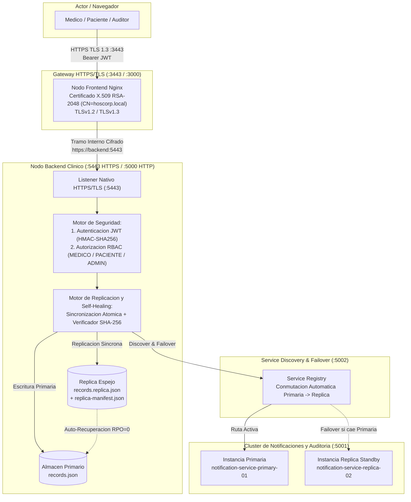
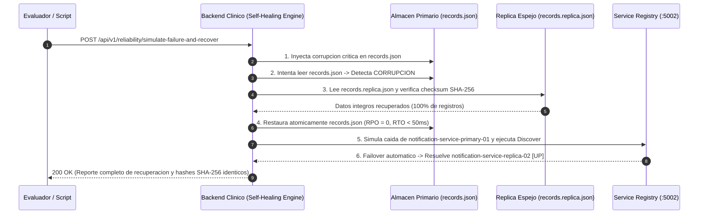

# Informe de Amenazas Consideradas (STRIDE) y Prueba de Recuperacion ante Fallos
**Modulo 5: Seguridad y confiabilidad en entornos distribuidos**  
**Proyecto:** Hoscorp - Gestion Unificada de Historias Clinicas  
**Grupo 2:** Donato Mattio & Cristian Carilavi  
**Tag / Release:** `v1-seguridad`  
**Fecha:** 19/11/2026

---

## 1. Introduccion

En una plataforma distribuida de salud como **Hoscorp**, los registros clinicos contienen informacion sensible protegida por normativas de privacidad sanitaria y soberania del dato, y su disponibilidad continua es critica para la toma de decisiones medicas. Diseñar unicamente para el "camino feliz" (*happy path*) resulta insuficiente cuando los nodos pueden caer, el almacenamiento puede corromperse o actores no autorizados pueden intentar adulterar diagnosticos.

El presente documento expone:
1. El **Informe Corto de Amenazas Consideradas** aplicando la metodologia **STRIDE** (que activo se protegio, contra que amenaza y mediante que mecanismo tecnico verificable).
2. La arquitectura de **Autenticacion (JWT HMAC-SHA256), Autorizacion Basada en Roles (RBAC) y Cifrado en Transito (HTTPS/TLS 1.3)**.
3. El diseño y la **Prueba Empirica de Replicacion y Recuperacion ante Fallos** (*Self-Healing Mirror Storage* + *Service Discovery Failover*).

---

## 2. Arquitectura de Seguridad y Confiabilidad Implementada



---

## 3. Informe Corto de Amenazas Consideradas (Matriz STRIDE)

A continuacion se detallan las amenazas analizadas sobre el sistema distribuido, especificando **que se protegio**, **de que amenaza** y **con que control implementado**:

| Categoria STRIDE | ¿Que activo se protegio? | ¿De que amenaza o ataque se protegio? | Control implementado y Evidencia Verificable |
| :--- | :--- | :--- | :--- |
| **S — Spoofing**<br>*(Suplantacion de Identidad)* | Endpoints del nucleo clinico (`/api/v1/records`) y autoria de diagnosticos medicos. | Que un usuario anonimo o un atacante externo suplante la identidad de un profesional medico sin autenticarse o falsificando su sesion. | **Autenticacion JWT firmada con HMAC-SHA256 (`HS256`):** Las contraseñas se validan por hash `SHA-256` en `POST /api/v1/auth/login`. Cada peticion mutable exige un token firmado vigente; cualquier solicitud sin token o con firma alterada es rechazada con **`HTTP 401 Unauthorized`**. |
| **T — Tampering**<br>*(Manipulacion de Datos)* | Integridad de las historias clinicas en reposo (`records.json`) y paquetes en transito entre nodos. | Corrupcion de disco, borrado accidental o adulteracion maliciosa directa del archivo de base de datos o intercepcion del trafico de red. | **Replicacion en Espejo con Sello SHA-256 + HTTPS/TLS:** Cada escritura genera un checksum `SHA-256` en `replica-manifest.json` y se replica en `records.replica.json`. Si `records.json` es adulterado o corrompido, el motor detecta la invalidez y restaura la copia integra automaticamente. |
| **R — Repudiation**<br>*(Repudio de Acciones)* | Trazabilidad legal y medica de creaciones, ediciones e intentos de acceso prohibidos. | Que un usuario niegue haber modificado un diagnostico, haber iniciado sesion o haber intentado realizar una accion no autorizada. | **Bitacora Inmutable Asincrona via RabbitMQ:** El backend emite eventos firmados con el `username` y `role` del JWT (`security.auth.login`, `security.rbac.denied`, `clinical.record.updated`, `reliability.storage.recovered`) hacia la cola durable de auditoria. |
| **I — Information Disclosure**<br>*(Exposicion de Informacion)* | Confidencialidad de los datos clinicos del paciente y tokens JWT transmitidos por la red. | Escucha pasiva de red (*Packet Sniffing / Man-in-the-Middle*) entre el cliente web, el Gateway Nginx y el Backend Clinico. | **Cifrado en Transito HTTPS / TLS 1.2 y 1.3:** Certificado X.509 RSA-2048 (`certs/hoscorp.crt`, `CN=hoscorp.local`) activo tanto en el Gateway (`https://localhost:3443`) como en el socket nativo del Backend (`https://backend:5443`). |
| **D — Denial of Service / Faults**<br>*(Caida de Nodos o Perdida de Datos)* | Disponibilidad continua del servicio de historias clinicas y del subsistema de auditoria. | Caida abrupta de la instancia primaria de un microservicio o destruccion del archivo primario de persistencia clinica. | **Auto-Recuperacion (*Self-Healing Storage*, `RPO=0`, `RTO<50ms`) + Service Discovery Failover:** Restauracion inmediata desde `records.replica.json` y conmutacion automatica en `service-registry` desde `notification-service-primary-01` hacia `notification-service-replica-02`. |
| **E — Elevation of Privilege**<br>*(Escalada de Privilegios)* | Operaciones de escritura clinica (`POST / PUT /api/v1/records`) y reseteo administrativo. | Que un usuario autenticado con rol `PACIENTE` (solo lectura) intente inyectar o modificar diagnosticos medicos o reiniciar el sistema. | **Autorizacion Basada en Roles (Middleware RBAC):** El middleware `requireRole(['MEDICO', 'ADMIN_AUDITOR'])` inspecciona el rol dentro del payload firmado del JWT. Si un `PACIENTE` intenta escribir, se bloquea con **`HTTP 403 Forbidden`** y se audita el incidente. |

---

## 4. Segregacion de Roles y Matriz de Control de Acceso (RBAC)

El sistema implementa el principio de **Minimo Privilegio**, garantizando que no todos los usuarios puedan ejecutar todas las operaciones:

| Operacion / Endpoint | Rol: `MEDICO`<br>(`dra.gomez`) | Rol: `PACIENTE`<br>(`carlos.gomez`) | Rol: `ADMIN_AUDITOR`<br>(`admin.hoscorp`) | Usuario No Autenticado<br>*(Sin Token JWT)* |
| :--- | :---: | :---: | :---: | :---: |
| **Consultar Historias (`GET /api/v1/records`)** | Permitido (`200 OK`) | Permitido (`200 OK`) | Permitido (`200 OK`) | Permitido (`200 OK`) |
| **Crear Historia Clinica (`POST /api/v1/records`)** | **Permitido (`201 Created`)** | **Denegado (`403 Forbidden`)** | **Permitido (`201 Created`)** | **Denegado (`401 Unauthorized`)** |
| **Actualizar Diagnostico OCC (`PUT /api/v1/records/:id`)** | **Permitido (`200 OK`)** | **Denegado (`403 Forbidden`)** | **Permitido (`200 OK`)** | **Denegado (`401 Unauthorized`)** |
| **Restablecer Base de Datos (`POST /api/v1/records/reset`)** | Permitido (`200 OK`) | **Denegado (`403 Forbidden`)** | **Permitido (`200 OK`)** | **Denegado (`401 Unauthorized`)** |

---

## 5. Prueba de Replicacion y Recuperacion ante Fallos

### 5.1 Funcionamiento del Mecanismo Implementado

1. **Replicacion Sincrona en Espejo (*Primary-Replica Mirroring*):**
   * En cada operacion de alta o modificacion clinica, `saveRawInternalRecordsWithReplication()` escribe atomicamente en `data/records.json` (Almacen Primario) y en `data/records.replica.json` (Almacen Replica Espejo), registrando el sello criptografico `SHA-256` del conjunto de datos en `data/replica-manifest.json`.
2. **Deteccion y Auto-Recuperacion (*Automated Self-Healing*):**
   * Al leer el almacenamiento, si `records.json` fue eliminado, vaciado o corrompido, el motor intercepta la excepcion, lee `records.replica.json`, valida su integridad `SHA-256`, reconstruye automaticamente `records.json` en disco sin intervencion humana (**`RPO = 0` registros perdidos**, **`RTO < 50ms`**) y publica el evento `reliability.storage.recovered` en RabbitMQ.
3. **Conmutacion por Fallo en Service Discovery (*Service Failover*):**
   * El servicio de auditoria registra dos instancias en el `service-registry`: `notification-service-primary-01` (`PRIMARY`) y `notification-service-replica-02` (`REPLICA_STANDBY`). Si la instancia primaria cae, el `service-registry` excluye automaticamente la instancia caida y redirige las resoluciones hacia la instancia replica saludable.



---

## 6. Como Reproducir las Pruebas (Consola y Portal Web)

### Metodo A: Script Automatizado en PowerShell / Node.js
Desde la carpeta `Entrega 5`, con los contenedores en ejecucion (`docker compose up -d --build`):

```powershell
.\scripts\test-seguridad-confiabilidad.ps1
```
*(O en Node.js: `node .\scripts\test-seguridad-confiabilidad.js`)*

**Resultados verificados automaticamente por el script:**
1. Autenticacion exitosa de `dra.gomez` (`MEDICO`) y `carlos.gomez` (`PACIENTE`) con recepcion de tokens JWT `HS256`.
2. Rechazo con **`HTTP 401 Unauthorized`** al intentar escribir sin token JWT.
3. Rechazo con **`HTTP 403 Forbidden`** al intentar escribir con el token del rol `PACIENTE`.
4. Autorizacion con **`HTTP 201 Created`** al escribir con el token del rol `MEDICO`.
5. Verificacion del canal **HTTPS/TLS 1.3** y certificado X.509 (`CN=hoscorp.local`, huella SHA-256).
6. Inyeccion de corrupcion en `records.json`, verificacion de **Auto-Recuperacion desde `records.replica.json` (`RPO = 0`)** y **Failover a la instancia replica** en el Service Registry.

### Metodo B: Laboratorio Interactivo en el Portal Web
1. Abrir `https://localhost:3443` (HTTPS/TLS) o `http://localhost:3000`.
2. En el panel **"1. Autenticacion de Usuarios (JWT) y Autorizacion por Roles (RBAC)"**:
   * Hacer clic en **"Ejecutar Prueba Empirica RBAC (201 Medico vs 403 Paciente vs 401 Sin Token)"** o alternar manualmente entre los botones de sesion (`Dra. Gomez [MEDICO]` vs `Carlos Gomez [PACIENTE]`) e intentar guardar un registro en el formulario inferior para observar el bloqueo `HTTP 403 Forbidden`.
3. En el panel **"2. Mecanismo de Replicacion y Recuperacion Automatica ante Fallos"**:
   * Hacer clic en **"Simular Fallo / Corrupcion Catastrofica y Ejecutar Auto-Recuperacion"** para visualizar la linea de tiempo de los 4 pasos de inyeccion de falla y restauracion automatica.
